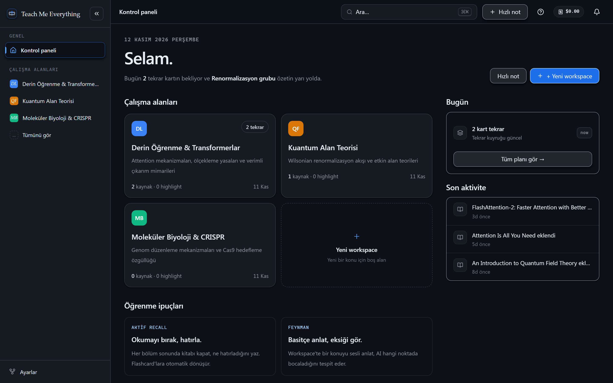
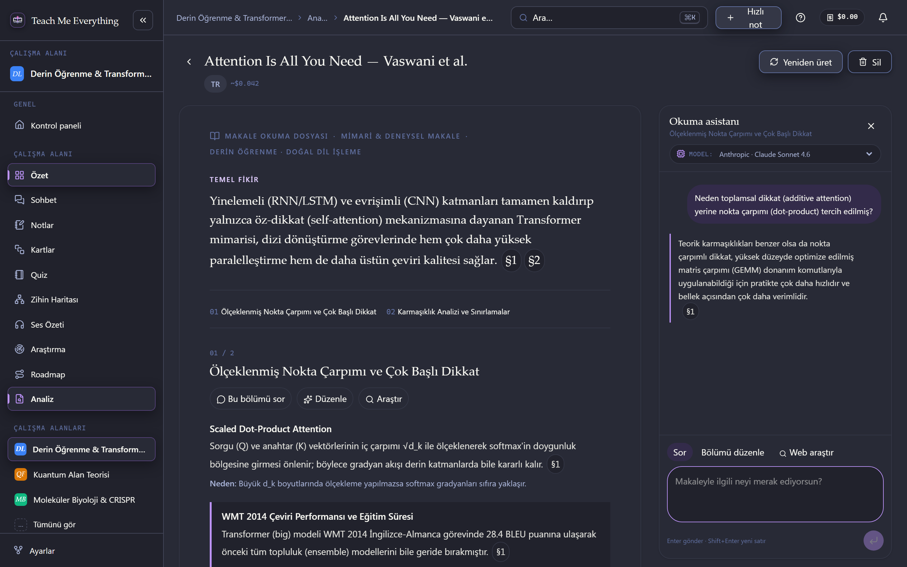
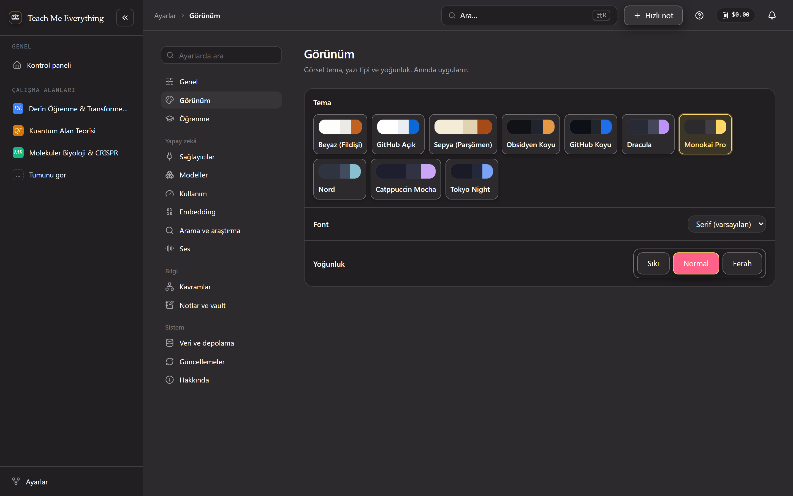
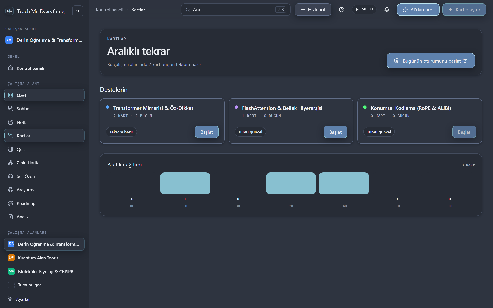
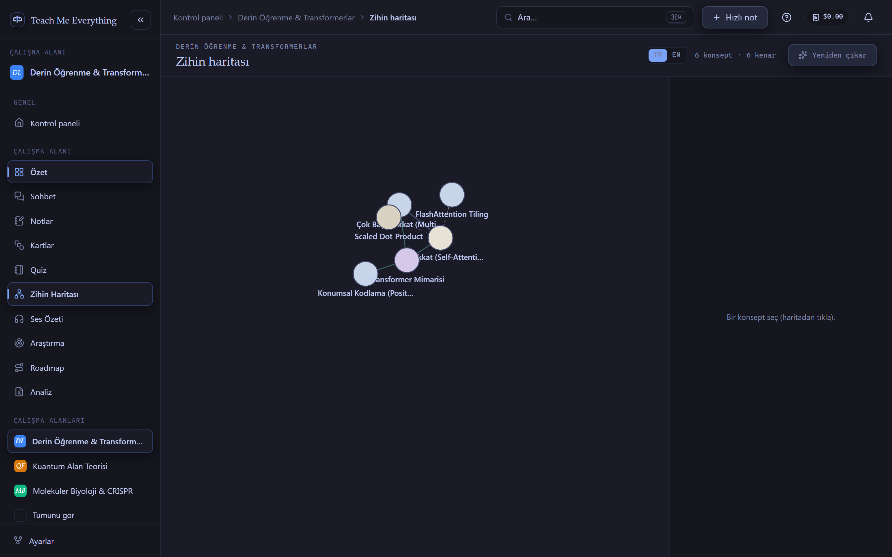

<div align="center">
  
  <h1>Teach Me Everything</h1>
  <p><strong>A local-first, AI-assisted active learning studio for deep reading, synthesis, and spaced repetition.</strong></p>
  <p>
    <a href="README.tr.md">🇹🇷 Türkçe Sürüm (Turkish README)</a> ·
    <a href="https://github.com/FurkanSahinnn/teach-me-everything/releases/latest">📦 Download Desktop App (Releases)</a>
  </p>
</div>

---

**Teach Me Everything** turns your own PDFs, DOCX files, research papers, Markdown notes, and web sources into structured workspaces, multi-stage article analyses, citation-verified AI reading assistants, SM-2 spaced-repetition flashcards, quizzes, concept mind maps, and guided study sessions.

## ✨ Visual Tour

### 1. Workspace Dashboard (`GitHub Dark` Theme)
Organize your study domains, track daily spaced-repetition queues, and pick up right where you left off.


### 2. Deep Article Analysis & Citation-Verified Reading Assistant (`Dracula` Theme)
Break complex academic papers into a structured reading brief (Central Idea, Method, Evidence, and Limitations). Select any passage to ask the AI Reading Assistant, switch models on the fly, or revise sections with verbatim source verification.


### 3. Rich Theme Studio (`Monokai Pro` Theme)
Choose from **10 carefully crafted themes** including *GitHub Dark*, *Dracula*, *Monokai Pro*, *Nord*, *Catppuccin Mocha*, *Tokyo Night*, *Obsidian Dark*, *Sepia (Parchment)*, *GitHub Light*, and *White (Ivory)*.


### 4. SM-2 Spaced Repetition & Flashcard Decks (`Nord` Theme)
Generate bilingual flashcards from your sources with AI, review due cards with the SM-2 algorithm, and monitor interval distributions and leech cards.


### 5. Interactive Concept Graph & Mind Map (`Tokyo Night` Theme)
Automatically extract core concepts, methods, and dependencies across your sources into an interactive force-directed mind map.


---

## 🚀 Installation (Desktop App Recommended)

> **Why Desktop?** The **Tauri Desktop App** is the primary and recommended way to use Teach Me Everything. It stores your BYOK API keys securely in your OS-native credential vault (Windows Credential Manager / macOS Keychain / Linux Secret Service), supports two-way local filesystem Vault sync, runs the bundled offline **Piper TTS** voice engine, and receives **in-app updates** automatically.

### Option A: Download Prebuilt Desktop Installer (Recommended for Users)
1. Go to the [**Latest GitHub Release**](https://github.com/FurkanSahinnn/teach-me-everything/releases/latest).
2. Download and run the installer for your system (`.msi` or `-setup.exe` on Windows).
3. Launch **Teach Me Everything** — whenever a new version is published, the app greets you on launch with an **Update Welcome Panel** (or installs updates automatically if enabled in *Settings → Updates*).

### Option B: Build or Run the Desktop App from Source
Prerequisites:
- **Node.js 20+**
- **Rust stable toolchain** (`rustup`) & platform build tools (Visual Studio C++ Build Tools + WebView2 on Windows)

```bash
# 1. Install dependencies (also fetches the local Piper TTS sidecar)
npm install

# 2. Run the native desktop app in development mode
npm run tauri:dev

# 3. Build a production desktop installer (.msi / .exe)
npm run tauri:build
```

---

## 🛠️ Local Web Development (Contributors Only)

The browser build (`http://localhost:3000`) is intended **strictly for local UI development and automated testing**. In browser mode, API keys are stored in IndexedDB (`apiKeys` table) without OS keychain backing, and desktop-only features (OS Keychain, filesystem watcher, Piper sidecar, native updater) are inactive.

```bash
npm run dev          # Start Next.js web dev server (http://localhost:3000)
npm run typecheck    # TypeScript check (tsc --noEmit)
npm run lint         # ESLint check
npm run test:run     # Unit & integration tests (Vitest)
npm run test:e2e     # End-to-end tests (Playwright)
```

---

## 🔄 Automated Releases & In-App Auto-Updater

- **CI/CD Release Pipeline (`.github/workflows/release.yml`):** Every push or merge to `main` (as well as `v*` tags) automatically resolves the next semantic version, builds signed Windows installers (`.msi` and NSIS `.exe`) plus the `latest.json` updater manifest, verifies signatures via `scripts/check-release.mjs`, and publishes the GitHub Release live.
- **In-App Update Panel (`UpdateCheckMount`):** When users open the installed desktop app and a newer release is available on GitHub Releases, an **Update Welcome Panel** appears with the new version badge, release notes, a one-click **"Update & Restart Now"** progress bar, and an optional toggle to auto-install future updates on launch.

---

## 🧱 Tech Stack

| Area | Technology |
| --- | --- |
| Desktop Shell | **Tauri v2** (Rust, OS Keychain, Updater, Native Tray & File Watcher) |
| Frontend Framework | **Next.js 16** (App Router, Static Export for Tauri) |
| Language | **TypeScript 5** & **Rust (2021 Edition)** |
| Styling & Themes | **Tailwind CSS v4** + 10 Custom CSS Token Themes |
| State & Storage | **Zustand** (preferences) + **Dexie.js / IndexedDB** & Local Markdown Vault |
| AI Providers (BYOK) | Anthropic, OpenAI, Google Gemini, OpenRouter, Groq, DeepSeek, Mistral, xAI, Perplexity, Ollama, LM Studio, llama.cpp |
| Local TTS | **Piper** offline neural text-to-speech sidecar |

---

## 📄 License

MIT — see [LICENSE](LICENSE).

The desktop build bundles a local text-to-speech engine (Piper). Bundled third-party components and their licenses — including **espeak-ng (GPL-3.0)** — are listed in [THIRD-PARTY-LICENSES.md](THIRD-PARTY-LICENSES.md).
