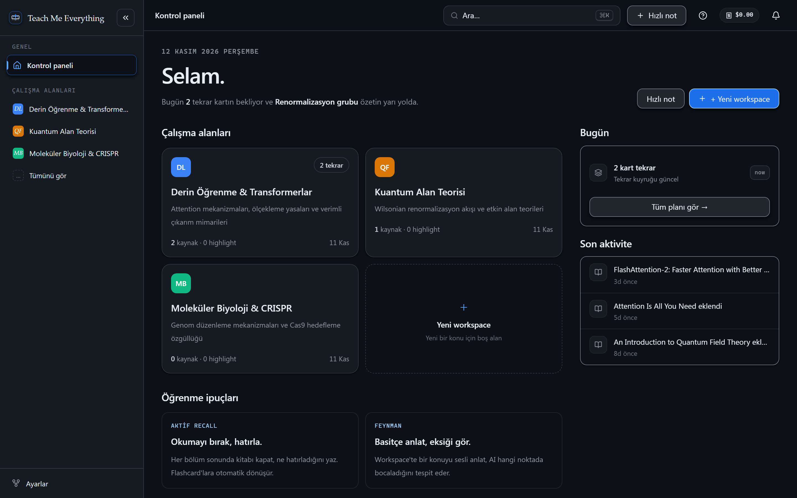
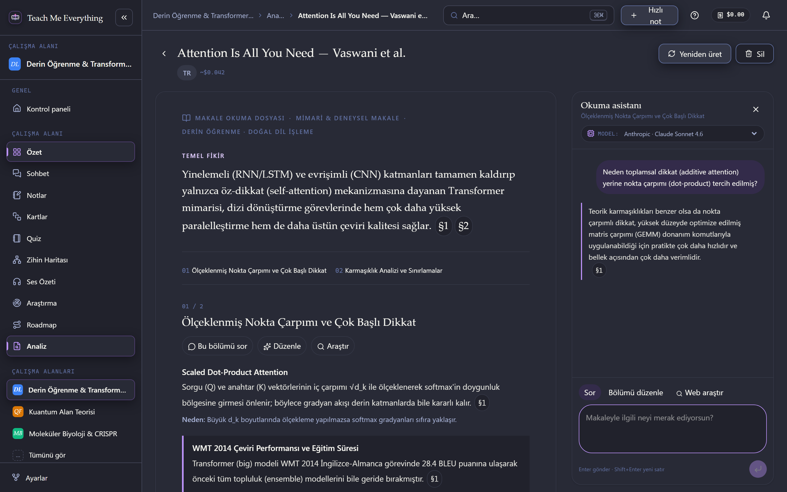
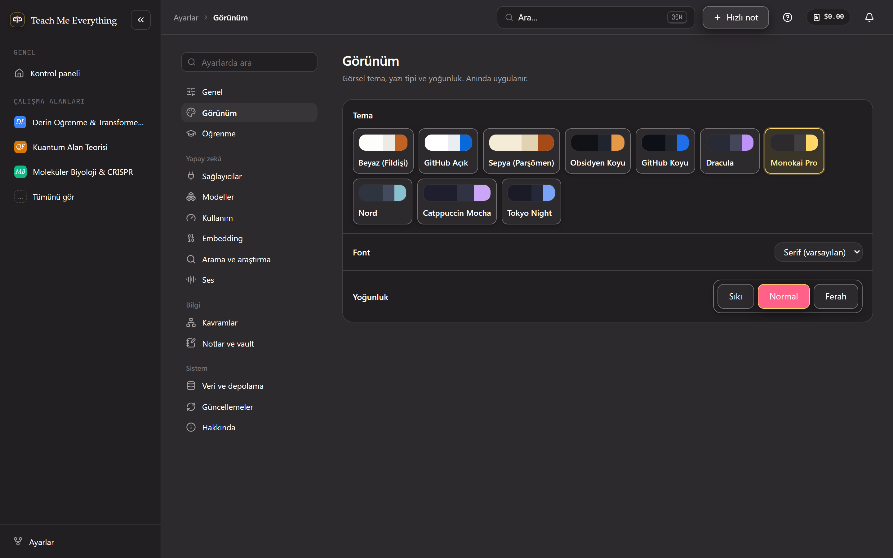
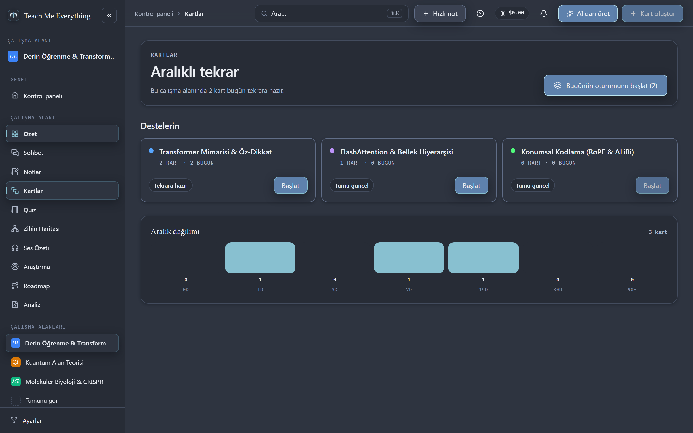
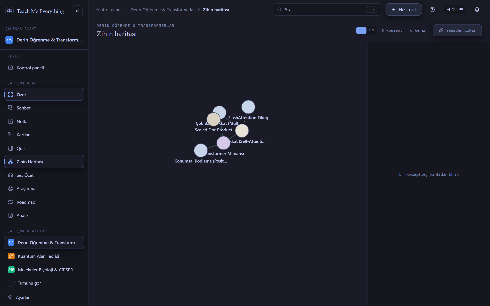

<div align="center">
  
  <h1>Teach Me Everything</h1>
  <p><strong>Derin okuma, makale analizi, bilgi sentezi ve aralıklı tekrar için yerel-öncelikli (local-first) AI öğrenme stüdyosu.</strong></p>
  <p>
    <a href="README.md">🇬🇧 English Version (İngilizce README)</a> ·
    <a href="https://github.com/FurkanSahinnn/teach-me-everything/releases/latest">📦 Masaüstü Uygulamasını İndir (Releases)</a>
  </p>
</div>

---

**Teach Me Everything**; kendi PDF, DOCX, akademik makale, Markdown ve notlarınızı içe aktararak çalışma alanları (workspaces), çok aşamalı makale analizleri, alıntı doğrulamalı AI okuma asistanı, SM-2 aralıklı tekrar kartları (flashcards), quiz oturumları, zihin haritaları ve rehberli çalışma akışları oluşturmanızı sağlar.

## ✨ Görsel Tur (Ekran Görüntüleri)

### 1. Çalışma Alanı ve Kontrol Paneli (`GitHub Koyu` Teması)
Çalışma alanlarınızı yönetin, günlük tekrar kuyruğunuzu takip edin ve son aktivitelerinize tek ekrandan ulaşın.


### 2. Derin Makale Analizi ve AI Okuma Asistanı (`Dracula` Teması)
Akademik makaleleri tek akışta inceleyin: Temel fikir, yöntem adımları, kanıtlar ve sınırlar. Anlamadığınız herhangi bir pasajı seçip **Okuma Asistanı**'na sorun, kullanılan AI modelini panel üzerinden anında görün/değiştirin veya bölümleri kaynak doğrulamalı olarak yeniden yazdırın.


### 3. Zengin Tema Stüdyosu (`Monokai Pro` Teması)
*GitHub Koyu*, *Dracula*, *Monokai Pro*, *Nord*, *Catppuccin Mocha*, *Tokyo Night*, *Obsidyen Koyu*, *Sepya (Parşömen)*, *GitHub Açık* ve *Beyaz (Fildişi)* dahil **10 özel tema** arasından çalışma tarzınıza uygun olanı seçin.


### 4. SM-2 Aralıklı Tekrar ve Kart Desteleri (`Nord` Teması)
Kaynaklarınızdan AI ile iki dilli flashcard'lar üretin, SM-2 algoritması ile günlük tekrar oturumları yapın ve aralık dağılımlarını takip edin.


### 5. Etkileşimli Konsept Grafiği ve Zihin Haritası (`Tokyo Night` Teması)
Kaynaklarınızdaki temel kavramları, yöntemleri ve birbirleriyle olan ilişkilerini etkileşimli zihin haritası üzerinde keşfedin.


---

## 🚀 Kurulum (Masaüstü Uygulaması Önerilir)

> **Neden Masaüstü Uygulaması?** Teach Me Everything'in birincil ve önerilen kullanım şekli **Tauri Masaüstü Uygulamasıdır**. Masaüstü sürümü; BYOK API anahtarlarınızı işletim sisteminin güvenli anahtar zincirinde (Windows Credential Manager / macOS Keychain / Linux Secret Service) saklar, yerel disk klasörüyle (Vault) çift yönlü senkronizasyon yapar, çevrimdışı **Piper TTS** ses motorunu çalıştırır ve **uygulama içi otomatik güncelleme** desteği sunar.

### Seçenek A: Hazır Masaüstü Kurulum Paketini İndirin (Kullanıcılar İçin Önerilen)
1. [**GitHub Releases (Son Sürüm)**](https://github.com/FurkanSahinnn/teach-me-everything/releases/latest) sayfasına gidin.
2. Sisteminize uygun kurulum paketini (`.msi` veya `-setup.exe`) indirip kurun.
3. **Teach Me Everything**'i başlatın — yeni bir güncelleme yayınlandığında uygulamayı açtığınızda sizi doğrudan **Güncelleme Karşılama Paneli** karşılar (veya *Ayarlar → Güncellemeler* altından tam otomatik kurulumu açabilirsiniz).

### Seçenek B: Masaüstü Uygulamasını Kaynak Koddan Çalıştırma / Derleme
Gereksinimler:
- **Node.js 20+**
- **Rust stable** (`rustup`) ve platform derleme araçları (Windows için Visual Studio C++ Build Tools + WebView2)

```bash
# 1. Bağımlılıkları kurun (yerel Piper TTS ses motorunu da otomatik hazırlar)
npm install

# 2. Masaüstü uygulamasını geliştirme modunda başlatın
npm run tauri:dev

# 3. Dağıtıma hazır masaüstü kurulum paketi (.msi / .exe) üretin
npm run tauri:build
```

---

## 🛠️ Yerel Web Geliştirme Sunucusu (Yalnızca Geliştiriciler İçin)

Tarayıcı sürümü (`http://localhost:3000`) **yalnızca arayüz geliştirme ve test süreçleri için** tasarlanmıştır. Tarayıcı modunda API anahtarları işletim sistemi kasası yerine tarayıcı IndexedDB (`apiKeys` tablosu) üzerinde tutulur ve masaüstüne özgü özellikler (OS Keychain, yerel dosya izleyici, Piper TTS sidecar, otomatik güncelleyici) devre dışıdır. Günlük kullanım için her zaman **masaüstü uygulamasını** tercih edin.

```bash
npm run dev          # Web geliştirme sunucusu (http://localhost:3000)
npm run typecheck    # TypeScript tip kontrolü (tsc --noEmit)
npm run lint         # ESLint kontrolü
npm run test:run     # Birim testleri (Vitest)
npm run test:e2e     # Uçtan uca testler (Playwright)
```

---

## 🔄 Otomatik Güncelleme Paneli & GitHub Release Mimarisi

- **Otomatik Release Pipeline (`.github/workflows/release.yml`):** `main` dalına (branch) bir push veya merge geldiğinde (ya da yeni bir `v*` etiketi gönderildiğinde), GitHub Actions otomatik olarak bir sonraki sürüm numarasını belirler, imzalı Windows kurulum paketlerini (`.msi` ve NSIS `.exe`) ve `latest.json` güncelleme manifestosunu derler, `scripts/check-release.mjs` ile imzaları doğrular ve sürümü yayınlar (`--latest`).
- **Uygulama İçi Güncelleme Karşılama Paneli (`UpdateCheckMount`):** Masaüstü uygulamasının kurulu olduğu cihazlarda kullanıcı uygulamayı açtığında yeni bir sürüm tespit edilirse, sürüm notlarını ve **"Şimdi Güncelle ve Yeniden Başlat"** butonunu içeren **Yeni Güncelleme Hazır** paneli kullanıcıyı karşılar. İstenirse *"Sonraki güncellemeleri açılışta otomatik kur"* seçeneğiyle güncellemeler tamamen otomatikleştirilebilir.

---

## 🧱 Teknoloji Yığını

| Alan | Teknoloji |
| --- | --- |
| Masaüstü Kabuğu | **Tauri v2** (Rust, OS Keychain, Auto-Updater, Sistem Tepsisi & Dosya İzleyici) |
| Framework | **Next.js 16** (App Router, Tauri için Statik Export) |
| Dil | **TypeScript 5** & **Rust (2021 Edition)** |
| Arayüz & Temalar | **React 19**, **Tailwind CSS v4** + 10 Özel Tasarım Tema |
| Durum & Veri Saklama | **Zustand** + **Dexie.js / IndexedDB** & Yerel Markdown Vault |
| AI Sağlayıcıları (BYOK) | Anthropic, OpenAI, Google Gemini, OpenRouter, Groq, DeepSeek, Mistral, xAI, Perplexity, Ollama, LM Studio, llama.cpp |
| Yerel Ses Motoru | **Piper** çevrimdışı metin-okuma (TTS) motoru |

---

## 📄 Lisans

MIT — bkz. [LICENSE](LICENSE).

Masaüstü sürümü yerel bir metin-okuma motoru (Piper) içerir. Paketlenen üçüncü taraf bileşenler ve lisansları — **espeak-ng (GPL-3.0)** dahil — [THIRD-PARTY-LICENSES.md](THIRD-PARTY-LICENSES.md) dosyasında listelenir.
